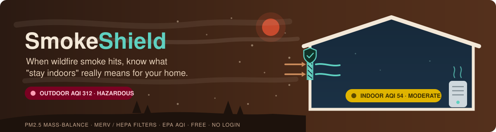

<div align="center">



<br/>

[](https://github.com/AnwarDebes/SmokeShield/releases)
[](pyproject.toml)
[](LICENSE)
[](tests/test_smokeshield.py)
[](frontend/)

**Indoor air during wildfire smoke. Free, no login, runs entirely in your browser.**

</div>

---

SmokeShield estimates the PM2.5 you would actually breathe inside your
home during a wildfire smoke event. Pick a home type (or enter your own
air leakage, ventilation, HVAC filter and fan settings) plus the
outdoor PM2.5, and a mass-balance model returns the indoor level, its
EPA AQI category, and which interventions would lower it most. It is a
research prototype (v0.1.0): it reproduces published indoor/outdoor
PM2.5 ratios for five home types (25 of 25 cases inside the published
bands, see `results/validation.json`), treats the home as one
well-mixed volume, and needs you to type in the outdoor PM2.5 yourself
(Limitations in [the paper](paper/smokeshield.pdf)).

▶ See this project in the film *Show Its Work*: https://youtu.be/pefnyZ-oCcM?t=2466

When the outdoor AQI hits 300, your phone tells you "stay indoors."
SmokeShield tells you what "indoors" actually means *for your home*:
the predicted PM2.5 level you would be breathing, the corresponding
EPA AQI category and mortality risk, and a ranked list of the four
interventions that would reduce it the most, with what each one costs.

This repository contains:

1. `smokeshield/`: a calibrated Python library: indoor PM2.5
   mass-balance ODE, MERV filter efficiencies, EPA AQI translation,
   GBD HRAPIE relative-mortality risk, and a 5-intervention ranker.
2. `frontend/`: a single-page client-side web app that ports the
   physics to JavaScript. No login, no analytics, no backend.
3. `experiments/`: three experiments that validate the model
   against published indoor/outdoor (I/O) measurements, rank
   interventions, and simulate two documented smoke events (LA
   Palisades, January 2025; Canadian smoke over the US Northeast,
   June 2023) plus a typical moderate-smoke day.
4. `paper/smokeshield.pdf`: the technical paper documenting the
   model, validation, and frontend.

## Running the frontend

The frontend is a single-page static app. No build step.

```bash
cd frontend
python3 -m http.server 8000      # or, from the repo root: make frontend
# open http://127.0.0.1:8000/
```

Or drop the four files (`index.html`, `app.js`, `styles.css`,
`about.html`) onto any static host (GitHub Pages, S3, Cloudflare
Pages, Netlify) and it works. Cost: $0/month.

## Running the Python library

```bash
pip install -e .
```

```python
from smokeshield import (
    HOME_ARCHETYPES, indoor_steady_state, evaluate_interventions,
)

profile = HOME_ARCHETYPES["typical_modern_merv8"]
C_in = indoor_steady_state(profile, C_outdoor_ugm3=200.0)
print(f"Indoor PM2.5: {C_in:.1f} ug/m^3")   # -> 50.0 ug/m^3

for r in evaluate_interventions(profile, C_outdoor_ugm3=200.0)[:3]:
    print(f"  {r['label']}: -{r['reduction_percent']:.0f}%")
```

## Running the experiments

```bash
pip install -e ".[dev]"   # the library plus pytest, which make test needs
make experiments       # validation, interventions, scenarios -> results/*.json
make figures           # produces paper/figures/*.pdf
make paper             # builds paper/smokeshield.pdf (needs pdflatex and bibtex)
make test              # runs the 12 unit tests
```

The Makefile runs `python3` with `PYTHONPATH=.` from the repo root.

## Validation

All 25 cases (5 archetypes × 5 outdoor concentrations) reproduce the
indoor/outdoor PM2.5 ratio reported in five published sources (NCCEH
2023, AAQR 2021, ACS ES&T Air 2024, AAQR 2021 fig 6, Persily 1998)
within the cited bands. See `results/validation.json` and the
paper's §3.

## Privacy

SmokeShield does not phone home. No network calls, no analytics, no
cookies. Profile data is stored only in the user's browser
`localStorage`. The Python library makes no network calls.

## License

Public domain (CC0 1.0). See `LICENSE`.
